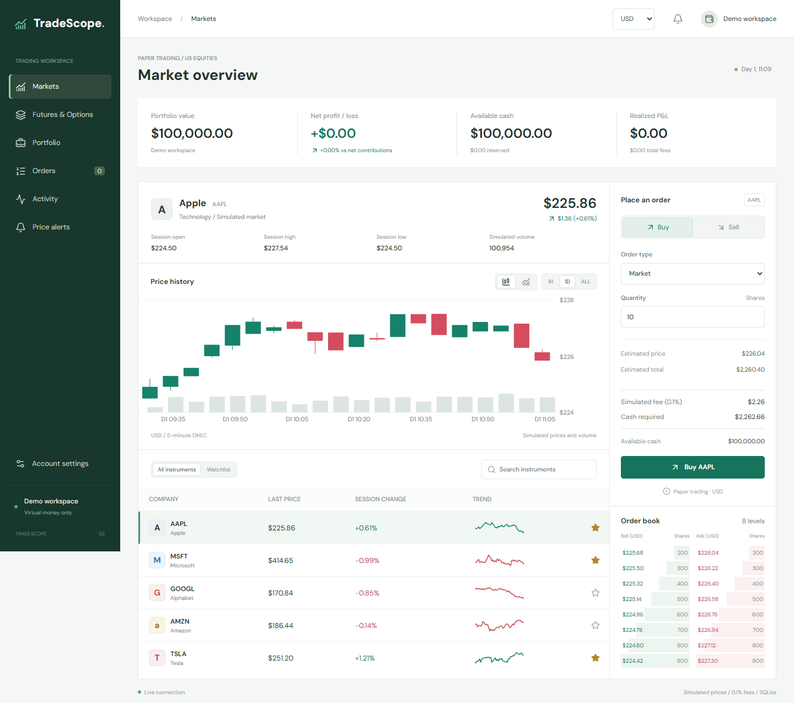
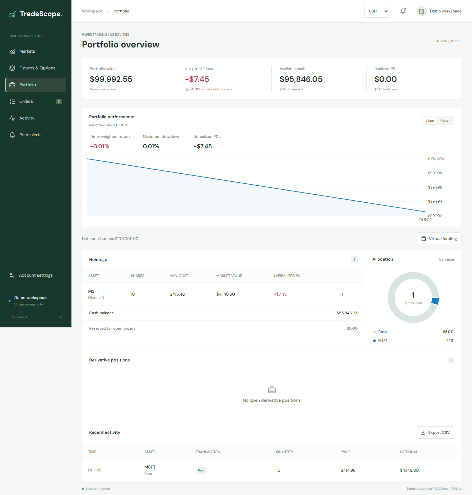
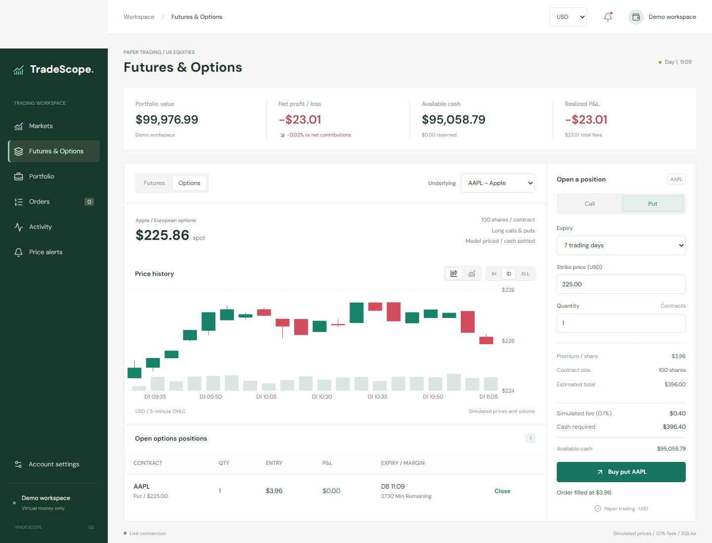

# TradeScope

A full-stack JavaScript paper-trading workspace with private accounts, simulated equities and derivatives, an auditable cash ledger, and USD/INR display preferences.

**Virtual money. Simulated prices. No brokerage connection.**



## Quick Start

Install Node.js 22.16 or newer, then clone this repository using its **Code** menu (or download and extract the ZIP). Open the project root in VS Code and run:

```powershell
npm ci
npm run dev
```

Use the URL printed in the terminal, normally **http://127.0.0.1:5173**. This starts the React frontend and Node.js backend together. Ctrl+C stops both. A second invocation prints the existing development URL instead of creating another engine. The launcher selects free ports if the preferred ports are occupied.

After the first install, subsequent starts only need:

```powershell
npm run dev
```

Use `npm.cmd` if PowerShell blocks `npm.ps1`. Requires Node.js 22.16 or newer; Node 22's built-in SQLite API may print an experimental-feature warning. No separate database installation, API key, paid service, or compiler is needed. Frontend edits reload automatically; restart the development command after backend changes.

## First Visit

Choose **Open demo workspace** for an isolated anonymous account, or **Register** using an email and a password of at least 10 characters. Each new account starts with $100,000 of virtual cash and no invented trading history. A demo account is tied to its browser session and cannot be recovered through login after signing out. Register for a reusable account.

Registration does not send email or verify mailbox ownership. Email verification, Google sign-in, and password-reset email are intentionally not integrated yet. Passwords are hashed; session credentials are held in private cookies, not browser local storage.

The shared market runs automatically by default. Closing the browser does not stop the server or its simulation. Set `AUTO_RUN=false` in an optional root `.env` to start paused. Only administrators can pause, advance, or configure the shared market.

### Administrator Setup

Register a normal account first, then grant it administrator access from this folder's terminal:

```powershell
npm run admin -- --email account@example.com
```

Use the email you registered. Reload the app afterward. This local command is the only account-promotion path; there is no public endpoint, shared admin password, or automatic first-user promotion. The **Administration** view contains market settings, storage counts, an audit trail, and preserved legacy-account values.

## Features

| Workspace      | Capabilities                                                                                                                                            |
| -------------- | ------------------------------------------------------------------------------------------------------------------------------------------------------- |
| Accounts       | Registration, sign-in/out, private sessions, demo access, per-account preferences, administrator role                                                   |
| Markets        | Five simulated US equities; instrument search; personal watchlist; candlestick/line chart; volume; session statistics; bid/ask depth                    |
| Trading        | Market, limit, stop-market and stop-limit stock orders; day/GTC validity; cash/share reservations; partial fills; self-trade prevention; simulated fees |
| Derivatives    | Long/short futures; long calls/puts; strike/expiry selection; margin and liquidation thresholds; countdowns; cash settlement and closing records        |
| Portfolio      | Holdings, average cost, cash, realized/unrealized P&L, allocation, recorded equity history, time-weighted return and drawdown                           |
| Orders         | Instrument/status/search filters; lifecycle details; execution and fee information; cancellation of unfilled quantities                                 |
| Activity       | Searchable executions and cash ledger; complete trade/ledger CSV exports in USD                                                                         |
| Alerts         | Private price alerts and in-app fill, cancellation, expiry, liquidation and trigger notifications                                                       |
| Funding        | Virtual deposits/withdrawals, balance validation and idempotent requests; funding is excluded from investment return                                    |
| Administration | Run/pause/step; speed, volatility, future-order fee rate and simulated FX configuration; audit log                                                      |

Prices are pushed indirectly through server-sent revision events: the browser fetches an authenticated snapshot after a revision. It also reconnects and performs a periodic refresh as a fallback. No WebSocket service or external quote provider is required.

## USD and INR

The currency selector changes displayed money values and persists with the account. **Accounting, order-price inputs, strike inputs, funding and exports remain in USD.** INR is a converted presentation of the same balances, not a separate wallet, Indian exchange, or foreign-exchange order book.

The initial configured conversion is **83 INR per USD**, explicitly a simulation assumption, not a current exchange-rate claim. Administrators can change it. INR mode displays the rate and settlement-currency disclosure. There is no live FX feed.

## Trading Rules

- Symbols: AAPL, MSFT, GOOGL, AMZN and TSLA. Company names are real, but prices and generated volume are synthetic. Each symbol has an independent price path and a separate price/time-priority book.
- Stock orders use whole shares, from 1 to 1,000 per order. Stock short selling is not supported. A market order requires sufficient executable liquidity. Limit orders may fill partially and retain the remainder.
- A synthetic market maker refreshes eight levels of bid/ask liquidity every simulated minute. User trades do not alter the random reference-price process. The chart's reference price is not necessarily an order's execution price.
- Stop orders trigger on the simulated reference price. Buy stops trigger at or above their stop; sell stops at or below it. Waiting orders reserve shares or estimated cash, but gaps may cause a stop-market order to be rejected for insufficient funds or liquidity at trigger time. A stop-limit order can trigger without filling.
- A day order expires at the next 390-minute session boundary. GTC orders stay open until filled or cancelled. Waiting stops are cancellable. Filled trades cannot be undone.
- The default fee is 10 basis points (0.1%). The rate is captured when an order is accepted. Partial-fill fees are calculated incrementally from cumulative notional to prevent per-fill rounding overcharges. Purchase fees enter stock cost basis; sale fees reduce realized P&L. Derivative entry/exit fees are recorded separately.
- Each futures/options contract represents 100 shares. Futures use 20% initial margin and a simplified cost-of-carry mark. Liquidation occurs when margin equity falls to 25% of initial margin; losses are not capped at the deposit.
- Options are long-only, European and cash-settled. Black-Scholes supplies theoretical marks. Calls/puts settle at nonnegative intrinsic value at expiry. Closing is not early exercise. Derivatives execute at model values, not a real derivative exchange book.
- There are no real holidays, weekends, taxes, dividends, corporate actions, exchange-specific contract calendars or daily futures variation-margin transfers.

## Data and Migration

Upgrades retain compatibility with the previous database setting, default database filename, and unexpired session cookies. Fresh installations use the TradeScope names below. Existing cookies are renewed under the new name without extending their original session lifetime.

The primary database is `.local/tradescope.sqlite`. On first launch, an existing `.local/state.json` is imported once and retained. A migration backup is also created at `.local/backups/pre-sqlite-state.json`. Existing accounts, holdings, cash, orders, positions and price history are preserved. New cash-ledger tracking starts from an explicit migration balance, not fabricated historic entries.

Legacy demo accounts remain archived from public account switching and visible in the administrator's preserved-account summary. They are not assigned to whoever registers first. New registrations and demos receive their own private account IDs.

SQLite stores identities, sessions, immutable cash entries, executions, order projections, idempotency results, audit events and the market-engine snapshot. Updates use one transaction; a failed action restores in-memory state. Only one market engine may use a database at a time. A local administrator command can update an identity without starting a second engine.

**Back up the database after stopping the server.** Do not overwrite it while the app is running. Account data is local to this machine; copying only CSV exports is not a full backup. Do not commit `.local/`, `.env`, caches, logs, or test artifacts.

Destructive global reset is intentionally disabled once accounts and ledgers exist. For a separate clean scenario, set `TRADESCOPE_DATABASE` to a new file. This protects existing account records.

## Project Layout

```text
frontend/src/
  components/     Order entry, books, charts, dialogs
  views/          Authentication, markets, portfolio, orders, activity, alerts, admin
  lib/            HTTP client and display formatting
  App.jsx         Authenticated workspace, navigation and live connection
backend/src/
  api/            HTTP routes, authorization boundaries and validation
  services/       Password/session handling and authentication rate limits
  domain/         Matching, pricing, accounting, analytics and simulation
  storage/        SQLite repository, SQL migrations and process locking
  server.js       Configuration, startup, timer and graceful shutdown
scripts/          Dev/build launchers and local administrator command
tests/            Domain, API, persistence and desktop/mobile browser checks
docs/             Architecture, database, security and API documentation
.github/workflows/ci.yml
```

## Commands

| Command                                        | Purpose                                                                 |
| ---------------------------------------------- | ----------------------------------------------------------------------- |
| `npm run dev`                                  | Start frontend and backend together                                     |
| `npm run admin -- --email account@example.com` | Promote a registered account locally                                    |
| `npm run build`                                | Build the frontend                                                      |
| `npm start`                                    | Serve the built app and API together, normally at http://127.0.0.1:3001 |
| `npm test`                                     | Run domain, authentication, API and storage tests                       |
| `npm run test:e2e`                             | Run browser workflows against the production build                      |
| `npm run check`                                | Run backend tests and build                                             |
| `npm run format:check`                         | Check formatting                                                        |
| `npm run format`                               | Apply formatting                                                        |

Build before running browser tests. Tests use a separate `.local/browser-tests-platform.sqlite` database and port 3041, not your normal simulation. They use installed Edge on Windows; elsewhere run `npx playwright install chromium`. GitHub Actions installs its browser dependencies and runs formatting, tests, build, browser checks and dependency audit. The workflow is configured locally; it runs after the repository is hosted on GitHub.

## Configuration

Optional values are documented in `.env.example`:

| Variable              | Default                      | Meaning                                                |
| --------------------- | ---------------------------- | ------------------------------------------------------ |
| `HOST`                | `127.0.0.1`                  | Backend bind address                                   |
| `PORT`                | `3001`                       | Backend port, or preferred dev port                    |
| `FRONTEND_PORT`       | `5173`                       | Preferred development UI port                          |
| `TRADESCOPE_DATABASE` | `.local/tradescope.sqlite`   | Independent database file                              |
| `AUTO_RUN`            | `true`                       | Run market time on startup                             |
| `DEMO_ENABLED`        | `true`                       | Allow anonymous demo-account creation                  |
| `AUTH_RATE_LIMIT`     | `20`                         | Authentication attempts per IP per 15 minutes          |
| `SECURE_COOKIES`      | `false`                      | Require HTTPS for cookies when set to true             |
| `APP_ORIGIN`          | Request origin in production | Expected browser origin; set explicitly behind a proxy |

## Boundaries and Next Integrations

This is a trusted local educational platform, not a brokerage or a hardened public financial service. Its single-process engine and snapshot persistence target modest local workloads. Price charts retain 2,340 minute samples; performance keeps up to 10,000 recorded snapshots per account; recent UI lists are bounded. The database retains transaction records, so storage grows with use.

MongoDB Atlas is deliberately deferred. The storage boundary makes that replacement manageable, but it still requires a repository implementation, migration and transaction/concurrency testing. Email verification and Google identity linking are also deferred; placeholder identity columns do not mean those services are connected.

Project-owned examples and labels contain no personal credits or fictional personal names. Third-party licenses, attribution, model names and tool-generated metadata remain intact. User-entered email addresses are stored privately to support login.

Read [architecture](docs/ARCHITECTURE.md), [database notes](docs/DATABASE.md), [API reference](docs/API.md), and [security/deployment notes](docs/SECURITY.md).

## Technology

- React, Vite, Recharts and Lucide for the responsive browser workspace.
- Node.js, Express and Zod for the API and request validation.
- Node's built-in SQLite with transactional persistence and an immutable cash ledger.
- `nodejs-order-book` for stock matching and `black-scholes` for option pricing.
- Node's test runner, Playwright and GitHub Actions for automated checks.

## Screenshots

Screenshots use simulated accounts and virtual funds.





## Contributing

See [CONTRIBUTING.md](CONTRIBUTING.md) for local setup, verification and pull-request guidance. Keep account databases, credentials and logs out of commits.

## License

Project-owned code is available under the [MIT License](LICENSE). Dependencies retain their respective licenses. This educational simulator provides no investment advice and does not execute real-money trades.
